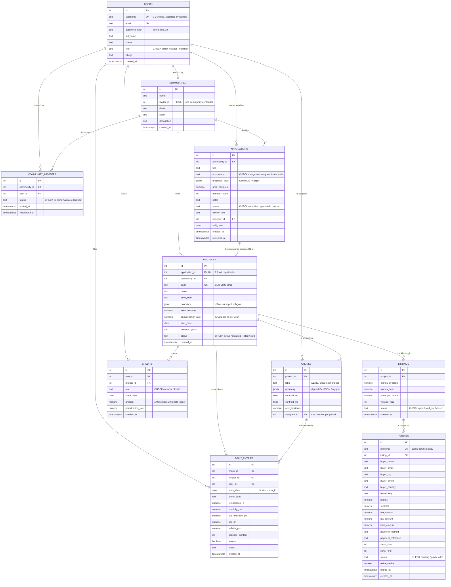

# Database Design — Blue Carbon Registry

PostgreSQL 14+ · 10 tables · no extensions required.

This document is the reference for the database layer: the entity-relationship diagram, every
relationship and its cardinality, the full schema of each table, and the constraints that turn the
platform's business rules into things the database itself refuses to break.

The canonical DDL lives in [`server/src/schema.sql`](server/src/schema.sql) and is applied by
`npm --prefix server run migrate`.

---

## Contents

- [Design decisions](#design-decisions)
- [ER diagram](#er-diagram)
- [Relationship catalogue](#relationship-catalogue)
- [Table schemas](#table-schemas)
- [Constraints that enforce business rules](#constraints-that-enforce-business-rules)
- [Indexes](#indexes)
- [Normalisation](#normalisation)
- [Transaction boundaries](#transaction-boundaries)
- [Data lifecycle and cascade behaviour](#data-lifecycle-and-cascade-behaviour)
- [Representative queries](#representative-queries)
- [Seeded data volumes](#seeded-data-volumes)

---

## Design decisions

**Geometry as GeoJSON in `jsonb`, not PostGIS.**
Every polygon — a community's proposed area, an officer's approved boundary, each individual parcel —
is stored as a GeoJSON `Polygon` object in a `jsonb` column. This removes the PostGIS extension from
the deployment requirements entirely, which matters for a system meant to run on modest government
or NGO infrastructure. The trade-off is that spatial predicates (`ST_Contains`, `ST_Area`, spatial
indexes) are unavailable in SQL; all geometry work happens in Node with `@turf/turf`
(`server/src/lib/geo.js`). Areas are computed once at write time and stored in a `numeric` column, so
no query ever needs to recompute them.

**Everything monetary or credit-bearing is `numeric`, never floating point.**
Credits, hectares, tonnes and money all use fixed-precision `numeric` with an explicit scale. Only
`centroid_lat` / `centroid_lng` use `double precision`, because they are display coordinates rather
than values that get summed.

**Denormalised `project_id` on `daily_entries` and `credits`.**
Both could reach the project through `chunks`, but they carry `project_id` directly. Almost every
read in the system is scoped to a project-day (the leader dashboard, the officer's project view,
credit settlement), and the direct column keeps those off a join. It is a deliberate, controlled
denormalisation — see [Normalisation](#normalisation).

**Status columns are `text` with `CHECK` constraints rather than `ENUM` types.**
Adding a value to a Postgres `ENUM` requires `ALTER TYPE` and is awkward inside a transaction; a
`CHECK` constraint is a single `ALTER TABLE`. The set of allowed values is still enforced.

**Additive-only migrations.**
`schema.sql` is written to be re-runnable: every `CREATE TABLE` is `IF NOT EXISTS`, and the order
settlement columns added after the first release appear as
`ALTER TABLE ... ADD COLUMN IF NOT EXISTS`. Running `migrate` against a populated database upgrades
it in place and never needs a drop.

---

## ER diagram



### Reading the diagram

The registry has one clear spine: **a user leads a community, the community applies, the application
becomes a project, the project divides into parcels, and each parcel accumulates daily entries that
mint credits.** Everything else hangs off that spine — listings and orders on the sale side,
`community_members` as the join between people and communities.

`USERS` participates in six different relationships because the same table backs all three roles.
Which relationships apply depends on `role`: an `admin` only ever appears as `applications.reviewer_id`,
a `leader` as `communities.leader_id`, a `member` as `chunks.assigned_to` and the author of entries.

---

## Relationship catalogue

| # | Parent | Child | Cardinality | Foreign key | On delete | Meaning |
|---|---|---|---|---|---|---|
| 1 | `users` | `communities` | **1 : 0..1** | `communities.leader_id` **UNIQUE** | `CASCADE` | A leader owns at most one community. The unique constraint is what makes it 1:1 rather than 1:N |
| 2 | `communities` | `community_members` | 1 : 0..N | `community_members.community_id` | `CASCADE` | The roster. Capped at 25 in application code |
| 3 | `users` | `community_members` | 1 : 0..N | `community_members.user_id` | `CASCADE` | A person may hold several invitations, but only one **accepted** membership |
| 4 | `communities` | `applications` | 1 : 0..N | `applications.community_id` | `CASCADE` | Historically many, but application code allows only one non-rejected application at a time |
| 5 | `users` | `applications` | 1 : 0..N | `applications.reviewer_id` | *(no action)* | The officer who last acted on it. Nullable — an unreviewed application has none |
| 6 | `applications` | `projects` | **1 : 0..1** | `projects.application_id` **UNIQUE** | `CASCADE` | Approval turns exactly one application into exactly one project |
| 7 | `communities` | `projects` | 1 : 0..N | `projects.community_id` | `CASCADE` | Denormalised shortcut; reachable through `applications` but queried directly |
| 8 | `projects` | `chunks` | **1 : 1..N** | `chunks.project_id` | `CASCADE` | Mandatory on the child side — a project is never created without parcels |
| 9 | `users` | `chunks` | 1 : 0..N | `chunks.assigned_to` | `SET NULL` | One member holds one parcel. `SET NULL` keeps the parcel and its history if the account is deleted |
| 10 | `chunks` | `daily_entries` | 1 : 0..N | `daily_entries.chunk_id` | `CASCADE` | At most one entry per parcel per calendar day |
| 11 | `projects` | `daily_entries` | 1 : 0..N | `daily_entries.project_id` | `CASCADE` | Denormalised for project-day scans |
| 12 | `users` | `daily_entries` | 1 : 0..N | `daily_entries.user_id` | `CASCADE` | Who filed it |
| 13 | `users` | `credits` | 1 : 0..N | `credits.user_id` | `CASCADE` | One row per person per day per role |
| 14 | `projects` | `credits` | 1 : 0..N | `credits.project_id` | `CASCADE` | The ledger a payout run reads |
| 15 | `projects` | `listings` | 1 : 0..N | `listings.project_id` | `CASCADE` | A project may be listed more than once, e.g. per vintage |
| 16 | `listings` | `orders` | 1 : 0..N | `orders.listing_id` | **`RESTRICT`** | A listing with retirements against it can never be deleted — the certificates must stay verifiable |

### Many-to-many relationships

There is one, resolved through an associative entity:

```
users  ──< community_members >──  communities
```

`community_members` is not a bare junction table: it carries `status`, `invited_at` and
`responded_at`, making it a first-class entity that models the *invitation lifecycle*, not just
membership. A row exists from the moment a leader sends a request, long before the person is a member
of anything.

### Notable cardinality choices

- **`communities.leader_id UNIQUE`** — the single constraint that makes "one leader, one community" a
  database guarantee rather than a hopeful check in a route handler.
- **`projects.application_id UNIQUE`** — makes double-approval structurally impossible. Even if two
  officers clicked Approve at the same instant, the second insert fails.
- **`orders.listing_id ON DELETE RESTRICT`** — every other FK cascades or nulls; this one refuses.
  A retirement certificate is a permanent public record, so nothing upstream of it may be deleted
  while it exists.

---

## Table schemas

### `users`

Every human in the system, all three roles in one table.

| Column | Type | Null | Default | Notes |
|---|---|---|---|---|
| `id` | `serial` | NO | sequence | **PK** |
| `username` | `text` | NO | | **UNIQUE.** Validated in app as `^[a-z0-9_.]{3,24}$` — this is the handle leaders search by |
| `email` | `text` | NO | | **UNIQUE** |
| `password_hash` | `text` | NO | | bcrypt, cost factor 10. Never returned by any endpoint |
| `full_name` | `text` | NO | | |
| `phone` | `text` | YES | | Used for the leader's tap-to-call chase list |
| `role` | `text` | NO | | **CHECK** `admin` \| `leader` \| `member` |
| `village` | `text` | YES | | |
| `created_at` | `timestamptz` | NO | `now()` | |

### `communities`

| Column | Type | Null | Default | Notes |
|---|---|---|---|---|
| `id` | `serial` | NO | sequence | **PK** |
| `name` | `text` | NO | | |
| `leader_id` | `integer` | NO | | **UNIQUE**, FK → `users(id)` `ON DELETE CASCADE` |
| `district` | `text` | YES | | |
| `state` | `text` | YES | | |
| `description` | `text` | YES | | |
| `created_at` | `timestamptz` | NO | `now()` | |

### `community_members`

The invitation lifecycle and the roster, in one table.

| Column | Type | Null | Default | Notes |
|---|---|---|---|---|
| `id` | `serial` | NO | sequence | **PK** |
| `community_id` | `integer` | NO | | FK → `communities(id)` `CASCADE` |
| `user_id` | `integer` | NO | | FK → `users(id)` `CASCADE` |
| `status` | `text` | NO | `'pending'` | **CHECK** `pending` \| `active` \| `declined` |
| `invited_at` | `timestamptz` | NO | `now()` | |
| `responded_at` | `timestamptz` | YES | | Set when the member accepts or declines |

**UNIQUE** `(community_id, user_id)` — one invitation per person per community.
**Partial UNIQUE** on `(user_id) WHERE status = 'active'` — see
[business rules](#constraints-that-enforce-business-rules).

### `applications`

| Column | Type | Null | Default | Notes |
|---|---|---|---|---|
| `id` | `serial` | NO | sequence | **PK** |
| `community_id` | `integer` | NO | | FK → `communities(id)` `CASCADE` |
| `title` | `text` | NO | | |
| `ecosystem` | `text` | NO | `'mangrove'` | **CHECK** `mangrove` \| `seagrass` \| `saltmarsh` |
| `proposed_area` | `jsonb` | NO | | GeoJSON `Polygon` traced by the leader |
| `area_hectares` | `numeric(12,3)` | NO | | Computed server-side with Turf; never trusted from the client |
| `member_count` | `integer` | NO | `0` | Snapshot of accepted members at submission time |
| `notes` | `text` | YES | | From the leader to the officer |
| `status` | `text` | NO | `'submitted'` | **CHECK** `submitted` \| `site_visit_scheduled` \| `site_visited` \| `approved` \| `rejected` |
| `review_note` | `text` | YES | | From the officer |
| `reviewer_id` | `integer` | YES | | FK → `users(id)` |
| `visit_date` | `date` | YES | | |
| `created_at` | `timestamptz` | NO | `now()` | |
| `reviewed_at` | `timestamptz` | YES | | |

**Status transitions** (enforced in `admin.routes.js`, constrained by the CHECK):

```
submitted ──> site_visit_scheduled ──> site_visited ──> approved
     │                 │                    │
     └─────────────────┴────────────────────┴──────────> rejected
```

Only `approved` creates a project; the transition is one-way and irreversible.

### `projects`

| Column | Type | Null | Default | Notes |
|---|---|---|---|---|
| `id` | `serial` | NO | sequence | **PK** |
| `application_id` | `integer` | NO | | **UNIQUE**, FK → `applications(id)` `CASCADE` |
| `community_id` | `integer` | NO | | FK → `communities(id)` `CASCADE` |
| `code` | `text` | NO | | **UNIQUE.** `BCR-<year>-<0000>`, generated at approval |
| `name` | `text` | NO | | |
| `ecosystem` | `text` | NO | | Copied from the application |
| `boundary` | `jsonb` | NO | | The **officer's surveyed** GeoJSON `Polygon`, which may differ from `applications.proposed_area` |
| `area_hectares` | `numeric(12,3)` | NO | | Recomputed from `boundary`, not copied |
| `sequestration_rate` | `numeric(8,3)` | NO | `6.500` | tCO2e per hectare per year, seeded from the ecosystem |
| `start_date` | `date` | NO | `CURRENT_DATE` | |
| `duration_years` | `integer` | NO | `2` | |
| `status` | `text` | NO | `'active'` | **CHECK** `active` \| `matured` \| `listed` \| `sold` |
| `created_at` | `timestamptz` | NO | `now()` | |

Keeping `proposed_area` and `boundary` in separate tables is intentional: the difference between what
a community asked for and what an officer measured is itself an auditable fact.

### `chunks` — the parcels

| Column | Type | Null | Default | Notes |
|---|---|---|---|---|
| `id` | `serial` | NO | sequence | **PK** |
| `project_id` | `integer` | NO | | FK → `projects(id)` `CASCADE` |
| `label` | `text` | NO | | `A1`…`A6`, `B1`… — reads like a map grid |
| `geometry` | `jsonb` | NO | | GeoJSON polygon clipped from the boundary |
| `centroid_lat` | `double precision` | NO | | Shown to the member to find the patch on the ground |
| `centroid_lng` | `double precision` | NO | | |
| `area_hectares` | `numeric(12,4)` | NO | | Four decimals — parcels can be small |
| `assigned_to` | `integer` | YES | | FK → `users(id)` `ON DELETE SET NULL` |

**UNIQUE** `(project_id, label)`. Rows are created only inside the approval transaction, one per
active member, by `splitIntoChunks()`.

### `daily_entries` — the monitoring record

The evidence table. Every credit in the system traces back to a row here.

| Column | Type | Null | Default | Notes |
|---|---|---|---|---|
| `id` | `serial` | NO | sequence | **PK** |
| `chunk_id` | `integer` | NO | | FK → `chunks(id)` `CASCADE` |
| `project_id` | `integer` | NO | | FK → `projects(id)` `CASCADE`. Denormalised |
| `user_id` | `integer` | NO | | FK → `users(id)` `CASCADE` |
| `entry_date` | `date` | NO | | Server's local date; the client cannot choose it |
| `photo_path` | `text` | NO | | `/uploads/chunk-<user>-<timestamp>.<ext>` |
| `temperature_c` | `numeric(5,2)` | NO | | App range −10 to 60 |
| `humidity_pct` | `numeric(5,2)` | NO | | App range 0 to 100 |
| `soil_moisture_pct` | `numeric(5,2)` | NO | | App range 0 to 100 |
| `soil_ph` | `numeric(4,2)` | YES | | Optional |
| `salinity_ppt` | `numeric(6,2)` | YES | | Optional |
| `saplings_planted` | `integer` | NO | `0` | |
| `watered` | `boolean` | NO | `true` | |
| `notes` | `text` | YES | | Free text for the leader |
| `created_at` | `timestamptz` | NO | `now()` | The wall-clock time it was filed |

**UNIQUE** `(chunk_id, entry_date)` — the constraint that makes the whole scheme credible.

### `credits` — the stewardship ledger

| Column | Type | Null | Default | Notes |
|---|---|---|---|---|
| `id` | `serial` | NO | sequence | **PK** |
| `user_id` | `integer` | NO | | FK → `users(id)` `CASCADE` |
| `project_id` | `integer` | NO | | FK → `projects(id)` `CASCADE` |
| `role` | `text` | NO | | **CHECK** `member` \| `leader` |
| `credit_date` | `date` | NO | | |
| `amount` | `numeric(8,3)` | NO | | `1.000` for members; `2.000 × participation` for leaders |
| `participation_rate` | `numeric(5,4)` | YES | | Stored so a leader's day can be audited later |
| `created_at` | `timestamptz` | NO | `now()` | |

**UNIQUE** `(user_id, credit_date, role)`. Member credits are written with
`ON CONFLICT DO NOTHING` (idempotent); leader credits with `ON CONFLICT DO UPDATE` (recomputed on
every member submission, so the figure is always current).

### `listings`

| Column | Type | Null | Default | Notes |
|---|---|---|---|---|
| `id` | `serial` | NO | sequence | **PK** |
| `project_id` | `integer` | NO | | FK → `projects(id)` `CASCADE` |
| `tonnes_available` | `numeric(12,3)` | NO | | Set by the officer at release |
| `tonnes_sold` | `numeric(12,3)` | NO | `0` | Incremented under a row lock at checkout |
| `price_per_tonne` | `numeric(10,2)` | NO | | |
| `vintage_year` | `integer` | NO | | |
| `status` | `text` | NO | `'open'` | **CHECK** `open` \| `sold_out` \| `closed`. Flips to `sold_out` automatically |
| `created_at` | `timestamptz` | NO | `now()` | |

`tonnes_sold` doubles as the serial cursor: the next order starts at `floor(tonnes_sold) + 1`.

### `orders` — retirements

| Column | Type | Null | Default | Notes |
|---|---|---|---|---|
| `id` | `serial` | NO | sequence | **PK** |
| `reference` | `text` | NO | | **UNIQUE.** `BC-<year>-<HEX>`, the public certificate key |
| `listing_id` | `integer` | NO | | FK → `listings(id)` **`ON DELETE RESTRICT`** |
| `buyer_name` | `text` | NO | | No account required |
| `buyer_email` | `text` | NO | | Where the certificate goes |
| `buyer_org` | `text` | YES | | |
| `buyer_phone` | `text` | YES | | |
| `buyer_country` | `text` | YES | | |
| `beneficiary` | `text` | YES | | The name printed on the certificate |
| `tonnes` | `numeric(12,3)` | NO | | Whole tonnes, enforced in app so serials stay exact |
| `subtotal` | `numeric(12,2)` | YES | | `tonnes × price_per_tonne` |
| `fee_amount` | `numeric(12,2)` | YES | | 4% registry and verification fee |
| `tax_amount` | `numeric(12,2)` | YES | | 18% GST on the fee |
| `total_amount` | `numeric(12,2)` | NO | | What was charged |
| `payment_method` | `text` | YES | | `card` \| `upi` \| `netbanking` |
| `payment_reference` | `text` | YES | | `CARD-…`, `UPI-…`, `NB-…` |
| `serial_start` | `integer` | YES | | First credit serial cancelled |
| `serial_end` | `integer` | YES | | Last credit serial cancelled |
| `status` | `text` | NO | `'paid'` | **CHECK** `pending` \| `paid` \| `failed` |
| `retire_credits` | `boolean` | NO | `true` | |
| `retired_at` | `timestamptz` | YES | | Set at retirement |
| `created_at` | `timestamptz` | NO | `now()` | |

The columns from `payment_method` onward were added post-release and are therefore nullable — older
rows would have no value for them. New rows always populate them.

---

## Constraints that enforce business rules

Each of these is a *policy* expressed as a *schema object*, so it holds even if a route handler is
buggy or a script writes directly.

| Business rule | Constraint | Table |
|---|---|---|
| A leader owns at most one community | `UNIQUE (leader_id)` | `communities` |
| **Nobody is an active member of two communities** | `CREATE UNIQUE INDEX one_active_community_per_member ON community_members (user_id) WHERE status = 'active'` | `community_members` |
| One invitation per person per community | `UNIQUE (community_id, user_id)` | `community_members` |
| **One entry per parcel per calendar day** | `UNIQUE (chunk_id, entry_date)` | `daily_entries` |
| **One credit row per person per day per role** | `UNIQUE (user_id, credit_date, role)` | `credits` |
| An application can be approved only once | `UNIQUE (application_id)` | `projects` |
| Project codes are globally unique | `UNIQUE (code)` | `projects` |
| Parcel labels are unique within a project | `UNIQUE (project_id, label)` | `chunks` |
| Certificate references are unique | `UNIQUE (reference)` | `orders` |
| A listing with retirements cannot be deleted | `FK ... ON DELETE RESTRICT` | `orders.listing_id` |
| Deleting a member keeps their parcel and its history | `FK ... ON DELETE SET NULL` | `chunks.assigned_to` |
| Roles, statuses and ecosystems are closed sets | 8 `CHECK` constraints | `users`, `community_members`, `applications`, `projects`, `credits`, `listings`, `orders` |

The **partial unique index** is worth singling out. A plain `UNIQUE (user_id)` would forbid a person
from ever being invited twice, including after declining. The `WHERE status = 'active'` predicate
allows any number of `pending` and `declined` rows while permitting exactly one `active` row — the
rule as actually intended, enforced with no trigger and no application logic.

### CHECK constraint reference

| Table | Column | Allowed values |
|---|---|---|
| `users` | `role` | `admin`, `leader`, `member` |
| `community_members` | `status` | `pending`, `active`, `declined` |
| `applications` | `ecosystem` | `mangrove`, `seagrass`, `saltmarsh` |
| `applications` | `status` | `submitted`, `site_visit_scheduled`, `site_visited`, `approved`, `rejected` |
| `projects` | `status` | `active`, `matured`, `listed`, `sold` |
| `credits` | `role` | `member`, `leader` |
| `listings` | `status` | `open`, `sold_out`, `closed` |
| `orders` | `status` | `pending`, `paid`, `failed` |

---

## Indexes

Twenty-four indexes: ten primary keys, eleven unique constraints, and three explicit performance
indexes.

### Performance indexes

| Index | Definition | Query it serves |
|---|---|---|
| `entries_project_date_idx` | `(project_id, entry_date)` | The leader dashboard's "who reported on this day", and `settleLeaderCredit()` counting a project-day. The hottest read in the system |
| `chunks_assigned_idx` | `(assigned_to)` | `GET /member/home` finding the signed-in member's parcel |
| `credits_project_idx` | `(project_id)` | Lifetime participation averages and the community credit total |

### Unique indexes (constraint-backed)

```sql
users_username_key                          (username)
users_email_key                             (email)
communities_leader_id_key                   (leader_id)
community_members_community_id_user_id_key  (community_id, user_id)
one_active_community_per_member             (user_id) WHERE status = 'active'
projects_application_id_key                 (application_id)
projects_code_key                           (code)
chunks_project_id_label_key                 (project_id, label)
daily_entries_chunk_id_entry_date_key       (chunk_id, entry_date)
credits_user_id_credit_date_role_key        (user_id, credit_date, role)
orders_reference_key                        (reference)
```

Each doubles as a lookup index — `orders_reference_key` is what makes the public certificate lookup
an index scan, and `daily_entries_chunk_id_entry_date_key` serves the "has this parcel reported
today?" check on every submission.

### Deliberately not indexed

Foreign keys such as `daily_entries.user_id` and `listings.project_id` have no standalone index.
The tables they point into are small (one project has at most 25 members) and every real query
already filters on an indexed column first. They are the obvious first additions if the dataset
grows by orders of magnitude.

---

## Normalisation

The schema is in **Third Normal Form**, with two documented, deliberate denormalisations.

**1NF** — every column holds a single atomic value. The `jsonb` geometry columns are the arguable
exception, but a GeoJSON polygon is atomic *to this application*: it is never queried by its parts,
only read and written whole. Its derived scalar, `area_hectares`, is materialised into its own column.

**2NF** — every table has a single-column surrogate primary key, so no partial dependency on a
composite key is possible.

**3NF** — no non-key column depends on another non-key column. Values that could have been copied
around are instead resolved by join: a parcel does not store its holder's name or phone, an order
does not store the project code, an entry does not store the community.

### The two denormalisations

| Column | Could be derived via | Why it is stored anyway |
|---|---|---|
| `daily_entries.project_id` | `chunk_id → chunks.project_id` | Every project-day query would otherwise join `chunks` just to filter. This is the single most frequent read path in the system, and the column is written once at insert and never updated |
| `credits.project_id` | `user_id → chunks.assigned_to → project_id` | That derivation is genuinely fragile — `chunks.assigned_to` is `SET NULL` on user deletion, which would orphan the credit's link to its project. Storing it keeps the ledger intact regardless |

Both are **write-once, never-updated** columns, so there is no update anomaly: nothing can drift out
of sync because nothing ever changes them.

Also worth noting: `projects.community_id` duplicates a path available through
`application_id → applications.community_id`. It is kept for the same reason — nearly every project
query filters or joins on community, and an application could in principle be deleted while its
project must not lose its owner.

---

## Transaction boundaries

Two operations must be all-or-nothing. Both use the `tx()` helper in `server/src/db.js`, which
checks out a dedicated client, issues `BEGIN`, and guarantees `ROLLBACK` on any throw.

### 1. Approving an application

`POST /api/admin/applications/:id/approve`

```
BEGIN
  SELECT  next project code
  INSERT  projects              (boundary, recomputed area, rate, dates)
  INSERT  chunks × N            (one per active member, assigned in the same statement)
  UPDATE  applications          SET status = 'approved', reviewer_id, reviewed_at
COMMIT
```

A crash midway would otherwise leave a project with no parcels, or parcels with no assignments —
either would silently break daily reporting for the whole community. `projects.application_id UNIQUE`
provides a second line of defence: a concurrent duplicate approval fails on insert rather than
creating a second project.

### 2. Buying credits

`POST /api/market/orders`

```
BEGIN
  SELECT  listing  ... FOR UPDATE      -- serialises concurrent buyers
  CHECK   requested tonnes <= available - sold
  UPDATE  listings  SET tonnes_sold = sold + qty,
                        status = CASE WHEN full THEN 'sold_out' ELSE status END
  INSERT  orders    (serial_start = floor(sold_before) + 1, serial_end, amounts, retired_at)
COMMIT
```

`FOR UPDATE` is the critical line. Without it, two buyers reading `tonnes_sold = 100` simultaneously
would both be assigned serials 101 onward — the same credits sold twice, which is precisely the
double-counting failure that carbon registries exist to prevent. The row lock forces the second
transaction to wait, re-read the committed value, and take the next block.

Verified behaviour across three consecutive purchases of 10, 4 and 3 tonnes: serials `1–10`,
`11–14`, `15–17`, with no gaps and no overlap.

---

## Data lifecycle and cascade behaviour

Deleting a row propagates as follows:

| Delete | Cascades to | Survives |
|---|---|---|
| a **member** (`users`) | their `community_members` rows, `daily_entries`, `credits` | their `chunks` — `assigned_to` becomes `NULL`, so the parcel and its geometry remain part of the project |
| a **leader** (`users`) | their `communities` → `applications` → `projects` → `chunks`, `daily_entries`, `credits`, `listings` | **nothing** — but `orders` block the delete if any credits were sold, via `RESTRICT` |
| a **community** | `community_members`, `applications`, `projects` and everything beneath | |
| an **application** | its `project`, and everything beneath | |
| a **project** | `chunks`, `daily_entries`, `credits`, `listings` | |
| a **listing** with orders | **refused** — `ON DELETE RESTRICT` | the certificate stays verifiable forever |

The `RESTRICT` on `orders.listing_id` therefore protects the entire chain: once a single tonne has
been retired, neither the listing, nor its project, nor its community, nor its leader can be deleted
without first dealing with the retirement.

---

## Representative queries

### Who has not reported today (leader dashboard)

```sql
SELECT ch.id, ch.label, u.full_name, u.phone,
       (SELECT MAX(entry_date) FROM daily_entries d WHERE d.chunk_id = ch.id) AS last_entry
  FROM chunks ch
  LEFT JOIN users u ON u.id = ch.assigned_to
  LEFT JOIN daily_entries de
         ON de.chunk_id = ch.id AND de.entry_date = $2
 WHERE ch.project_id = $1
   AND ch.assigned_to IS NOT NULL
   AND de.id IS NULL
 ORDER BY ch.label;
```

The `LEFT JOIN ... WHERE de.id IS NULL` anti-join is served by
`daily_entries_chunk_id_entry_date_key`.

### Leader credit settlement (runs on every member submission)

```sql
INSERT INTO credits (user_id, project_id, role, credit_date, amount, participation_rate)
VALUES ($1, $2, 'leader', $3, $4, $5)
ON CONFLICT (user_id, credit_date, role)
DO UPDATE SET amount = EXCLUDED.amount,
              participation_rate = EXCLUDED.participation_rate;
```

The upsert is what allows the same day to be recalculated any number of times without ever creating a
duplicate ledger row.

### Lifetime participation, which discounts sellable carbon

```sql
SELECT COALESCE(AVG(participation_rate), 0) AS lifetime_participation
  FROM credits
 WHERE project_id = $1 AND role = 'leader';
```

Because exactly one leader credit row exists per project-day, this average *is* the mean daily share
of parcels that reported — no `DISTINCT`, no grouping, no double counting.

### Payout distribution (the ledger a disbursement run would read)

```sql
SELECT u.id, u.full_name, u.role,
       SUM(c.amount)                                   AS credits,
       SUM(c.amount) / SUM(SUM(c.amount)) OVER ()      AS share
  FROM credits c
  JOIN users u ON u.id = c.user_id
 WHERE c.project_id = $1
 GROUP BY u.id, u.full_name, u.role
 ORDER BY credits DESC;
```

The window function over the grouped sum yields each person's fraction of the community's total in a
single pass — this is the query that turns daily attendance into money.

### Public certificate verification

```sql
SELECT o.*, p.code AS project_code, p.name AS project_name,
       c.name AS community_name, l.vintage_year
  FROM orders o
  JOIN listings l   ON l.id = o.listing_id
  JOIN projects p   ON p.id = l.project_id
  JOIN communities c ON c.id = p.community_id
 WHERE o.reference = $1;
```

An index scan on `orders_reference_key` followed by three primary-key lookups.

---

## Seeded data volumes

After `npm run db:reset`:

| Table | Rows | What they are |
|---|---|---|
| `users` | 20 | 1 officer, 2 leaders, 17 members |
| `communities` | 2 | Gosaba Tidal Collective, Rajnagar Mangrove Sangha |
| `community_members` | 16 | 10 accepted in Gosaba, 6 in Rajnagar |
| `applications` | 2 | 1 approved, 1 awaiting review |
| `projects` | 1 | `BCR-2026-0001`, 140.805 ha |
| `chunks` | 10 | One parcel per Gosaba member, 8.0–19.8 ha each |
| `daily_entries` | 253 | 30 days across 10 parcels at ~84% participation |
| `credits` | 283 | 253 member rows + 30 leader rows, one per project-day |
| `listings` | 1 | 148.5 tCO2e at ₹1,450 |
| `orders` | 0 | Buy from the marketplace to create one |

`credits` = `daily_entries` + one leader row per day, which is the invariant the unique constraints
guarantee: exactly one credit per member per reporting day, and exactly one per leader per calendar
day of the project.
